# PRD: ResisXV
Andrés Rojas | Northwestern University | PM101
Date last updated: November 12, 2026

Product Requirements Document

ResisXV is a proposed employer-supported service for occasional overnight stays near work. This document defines the worker experience, the funding decision and the operating requirements needed to test one complete stay.

Modality: responsive mobile website for workers; responsive employer and operations views. The product is specified here, but has not been deployed as a booking service.

Riskiest hypothesis: acceptable accommodation, an affordable personal contribution and authorized employer funding can overlap within a financially workable service.

Reassessment: end of Week 6 for readiness; end of Week 12 for the pilot decision. Continue only if the funding, supply, outcome and cost gates in Metrics pass. Weeks begin when staffing and a sponsor are confirmed; no launch date is committed.

Sections marked [H] contain proposed requirements, estimates or hypotheses that have not been tested. Interview accounts are labelled I1–I4. Design screens contain fictional demonstration data.

## Contents

- Vision
- Motivation: personas, unmet needs, alternatives, differentiation and timing
- Key Path Scenarios: worker, employer and operations
- Detailed Design & Features Description
- Milestones / Timing
- Metrics
- Facebook Ads
- Pricing Structure
- Projected Costs
- Operational Needs
- Risks
- Partnerships
- International
- Group Members
- Sources and Open Items

<!-- page -->
## Vision

For Mexico City workers with long commutes who need rest between workdays, ResisXV is an employer-supported lodging service for occasional nights near work. Unlike arranging lodging alone, it would make the worker’s personal cost and company support clear before a stay is confirmed. [H]

## Motivation

### Primary Persona

The original generated persona illustration appears in the downloadable PRD PDF.

**Name:** Sebastián, I1.
**Type:** Operational employee with a long commute and limited ability to pay for lodging.

**About:** Sebastián lives in Chimalhuacán and works near Barranca del Muerto. He reports leaving home around 5:00 a.m., travelling roughly two hours outbound and arriving home around 10:00–10:30 p.m. His reported transport expense is MXN 50 per day. These are his accounts, not a measured travel diary. [S1–S2]

Sebastián brings meals from home and values weekends with his children. He has considered rooms near work but rejected their conditions, price and lack of trust. He says he cannot pay for lodging independently and suggests employer support. A nearby bed would only help if the arrangement fits his actual workday, personal finances and household responsibilities.

**Job to be done:** When consecutive workdays and a long journey leave little time to recover, I want a feasible way to rest near work so that I can face the next day without destabilizing my household.

The image is the original generated illustration from the earlier José Martínez persona document. It is reused as a visual reference, not as a photograph of Sebastián. The current research persona and location remain Sebastián and Barranca del Muerto. [S6]

<!-- page -->
### Primary Persona Goals and Constraints

**Goals / Tasks**

- Recover usable time between demanding workdays.
- Understand whether one night near work is feasible before making a commitment.
- Keep the primary home and decide separately about each proposed stay.

**Needs / Implications**

- An acceptable place with documented conditions and reliable access information.
- A clear company contribution and a personal amount he can accept.
- An explanation and an exit when support or suitable accommodation is unavailable.

**Fears and Frustration**

Long journeys reduce the time available at home. Nearby rooms have not appeared trustworthy or affordable. An unclear approval could leave him travelling to an unconfirmed place or facing a charge he cannot pay. The last concern is a design risk, rather than an observed booking incident. [S1–S2]

**Why is he a challenge?**

The worker receives the benefit, but an employer may control whether the stay can happen. A shorter commute alone does not establish that he wants to spend a night away from home. His acceptable copay, actual rest gain and willingness to repeat remain unmeasured. The MXN 100 limit reported in I4 does not belong to Sebastián.

### Secondary Personas

**Angélica, I3 — emergency-use worker.** Angélica lives in Ecatepec and works near Insurgentes Sur / Parque Hundido. She reports approximately 2 hours 15–20 minutes each way and MXN 45 per day in transport. Household tasks and family meals require her return home. Regular lodging is outside her budget; an exceptional night may be worth exploring. Her account limits the assumption that every long-distance commuter is a recurring customer. [S1–S2]

**I4 — flexible-stay exploratory record.** The record labelled Jocelyn / Manolo describes a younger worker travelling from Xochimilco to Zona Rosa / Juárez. It emphasizes short commitments, cleanliness, secure belongings and a private bathroom. The corrected stated limit is MXN 100 per night. Identity and participant count remain unresolved, so this remains one record and is not combined with I1. [S1–S2]

**Luis Felipe, I2 — buyer reference.** A construction operations director describes approximately 150 workers, concerns about worksite sleeping and a possible company-wide budget of MXN 3,000–4,000 per week. He worries about conflict if only some workers receive support. The amount is interest expressed in an interview, not an approved fund. He is not established as Sebastián’s employer or as the final purchasing authority. [S1–S2]

<!-- page -->
### Unmet Needs

The MRD identifies recovery time, affordable and trustworthy accommodation, and household/funding fit as the main problem themes. The evidence comprises four supplied summary records: three worker records and one employer record. It does not support population percentages or product adoption claims. No paid stays, verified rest outcomes or authorized funding agreements are reported. [S1–S2]

| Need | Evidence carried from the MRD | Product implication |
|---|---|---|
| More time to recover | I1, I3 and I4 describe long or variable travel. Actual sleep loss is unmeasured. | Measure rest separately from travel time saved. |
| An affordable personal commitment | I1 cannot self-fund; I3 lacks a recurring budget; I4 states a limit. | Show copay before submission; block a commitment above the accepted cap. |
| Confidence in the place | I1 and I4 report unsuitable rooms. | Display sourced conditions, access hours and a responsible contact. |
| A stay that fits home responsibilities | I3 needs to return nightly; I1 describes understanding at home. | Offer one-night choice; make household details optional. |
| A controllable company expense | I2 suggests a shared budget and raises fairness. | Require an authorized period, rules and a review route. |

### Jobs and Hiring Criteria

The beneficiary is the worker. The worker and operations coordinator execute the arrangement. The employer approver authorizes subsidy. Their jobs overlap, but none can substitute for another’s consent. The following criteria are design hypotheses, not scored research results. [H]

| Category | Worker’s job in a specific situation | Proposed hiring criterion |
|---|---|---|
| Functional | Before consecutive workdays, find a feasible recovery arrangement. | At least 60 additional self-reported rest minutes versus a comparable commute night. |
| Functional | Before committing, know the full personal expense. | Quoted personal cost does not exceed the accepted cap. |
| Functional | On arrival, reach the agreed accommodation. | Access within the agreed arrival window. |
| Emotional | When assessing an unfamiliar room, feel confident in the conditions. | Worker can identify the evidence and responsible contact. |
| Emotional | When choosing a night away, retain control of the decision. | Decline without losing unrelated employment benefits. |
| Emotional | When support is scarce, understand the decision. | Receive the applicable rule and a review route. |
| Ancillary | Before requesting, coordinate the required night and hours. | One date and complete arrival/departure window recorded. |
| Ancillary | When plans change, understand cancellation consequences. | Terms and expected charges shown before cancellation. |
| Ancillary | After the stay, resolve the actual charge. | Every discrepancy remains assigned until resolved. |

Importance and satisfaction scores were not collected. No numerical opportunity ranking is presented. H4 affordability and H5 employer feasibility remain the first gates because I1 cannot independently pay. [S2]

<!-- page -->
### Existing Solutions

**Returning home.** This is the observed default and the strongest low-cost substitute. It preserves household routines and avoids an additional lodging charge. Its weakness is the travel burden. For workers like Angélica, the household benefit may still outweigh the time saved by staying nearby.

**Nearby rooms or longer rentals.** A stable room can reduce repeated coordination and may suit someone who needs frequent stays. I1 and I4 report poor fit on conditions, price or commitment. Those accounts do not prove that all local rooms are unsuitable. A matched local search is still required.

**Direct motel booking.** Existing providers already offer rooms, access procedures and direct service. Hotel y Villas Patriotismo publishes a Villa Master at MXN 1,290 for two people for six hours, including listed taxes. That is a specific public product, not a quote for a worker’s complete overnight rest window. ResisXV must compare date, hours, occupancy and total terms before claiming an advantage. [S7]

**Direct hostel booking.** Hostal Regina lists dormitories and private rooms, including private-bathroom options. Existing bed-based inventory could meet some workers’ needs. Shared facilities, atmosphere, location and arrival hours must be assessed for the actual occasion. The MRD’s earlier USD 15 example is not carried forward as a verified current offer. [S8]

**Worksite sleeping.** I2 reports that some workers sleep at worksites. It may avoid an external lodging charge, but permission, conditions and suitability have not been assessed. It is not established as Sebastián’s current practice. [S1]

**Employer coordination without a platform.** A manager could arrange an acceptable room using messages and a spreadsheet. This substitute may be sufficient for a small pilot and should be tested before building a full product. ResisXV must eventually justify its software through fewer errors, clearer costs or less coordination effort. [H]

| Decision criterion | Direct booking | Employer concierge | Proposed ResisXV |
|---|---|---|---|
| Existing room supply | Provider supplies it. | Uses provider supply. | Uses provider supply; none owned. |
| Company contribution | Requires separate agreement. | Can be arranged manually. | Recorded with request and shared fund. |
| Worker liability | Provider terms apply. | Depends on clear coordination. | Quote, cap and terms accepted together. |
| Administrative effort | Worker handles booking. | Coordinator handles each case. | Structured records; benefit untested. |

**Switching decision:** if a direct provider or manual employer arrangement delivers the same outcome at lower total effort and cost, retain the lighter service or stop development.

<!-- page -->
### Differentiation

The proposed difference is an affordable, explicit personal commitment backed by authorized company support and acceptable stay conditions. It is not a new type of room. Motels and hostels can be competitors, suppliers or both. ResisXV adds value only if its funding and coordination make an otherwise impractical night usable. [S2]

For Sebastián, the first question is whether he can use the stay without an expense he cannot meet. For the employer, the question is whether a limited shared fund can support a clear purpose without uncontrolled obligations. The product therefore connects the quote, company contribution, worker acceptance and provider confirmation in one record. [H]

There is no demonstrated proprietary supply, exclusive partnership or cost advantage. An established provider could add employer billing. A coordinator could copy the workflow with simple tools. The proposed advantage must be earned through reliable execution and measured value.

### Why Now?

The reason to test now is the project’s readiness for a bounded experiment: interview summaries, stories, a journey, MVC and wireframes exist. That makes an initial test concrete. It does not establish a sudden change in lodging demand, worker behavior or employer budgets. [S2–S5]

INEGI reports 4.9 million employed residents in Mexico City in Q1 2026. This provides historical scale context, not the number of eligible commuters or evidence of demand growth. It also excludes State of Mexico residents such as Sebastián from that resident population. [S9]

### Market Context Carried from the MRD

The MRD uses a planning scenario of 10% of that population, 24 useful nights per year and MXN 250–500 in gross stay value. The resulting scoped TAM is 490,000 workers, 11.76 million nights and MXN 2.94–5.88 billion annually. Every qualification, frequency and price input is assumed. This is market spending across solutions, not ResisXV revenue. [H; S2]

At an assumed 1% serviceable share, SAM becomes 4,900 workers and 117,600 nights annually. A proposed 100-worker pilot network using 12 nights each would imply 1,200 nights, but neither participants nor inventory are secured. The actual obtainable market can be zero. Funding constrains the test much earlier than these market figures.

### NEW since MRD

The PRD adds explicit request states, transaction checks, role permissions, an operations work queue, acceptance conditions, cost ranges and a Week 12 reassessment. These are implementation proposals. They do not represent additional interviews, validated pricing or completed pilot results. [H]

<!-- page -->
## Key Path Scenarios

All scenarios use a responsive website. Workers can open it on a phone without installing an app; employers can use a larger screen. The following steps describe intended behavior. The existing wireframes are static illustrations, with demo prices and controls. [H; S5]

### Use Case 1: Choose a Night and Check Support — Sebastián

**Trigger:** Sebastián anticipates a difficult return before another workday. **End state:** he knows whether to review accommodation or leave without a request. Stories S03, S05 and S08.

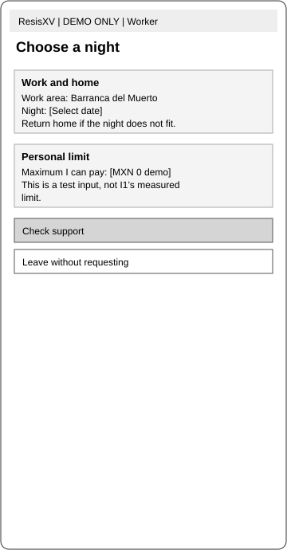

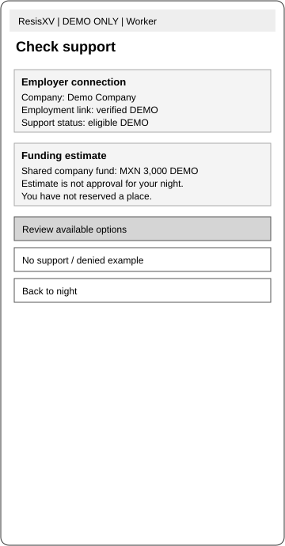

**1. Choose a night — F01.** After verified access, Sebastián enters the work area, date and maximum amount he can personally pay. The server associates the draft with his worker ID and validates the required stay window. Entering a personal cap does not establish willingness to pay for an actual offer.

**2. Check support — F02.** The system reads his verified company connection and the current support policy. It distinguishes eligibility from approval and shows that no room or money has been reserved. A current policy can support an estimate; a missing employer connection cannot.

**3. Continue or stop.** If support may be feasible, he reviews options in F03. If no eligible program exists, F09 explains the reason and review contact. He can leave without making a request. The system does not automatically move a worker who cannot self-fund into a self-pay booking.

<!-- page -->
### Use Case 2: Review Accommodation and Accept One Quote — Sebastián

**Trigger:** a specific night may be fundable. **End state:** Sebastián accepts one current quote or declines. Stories S08, S10, S12 and S13.

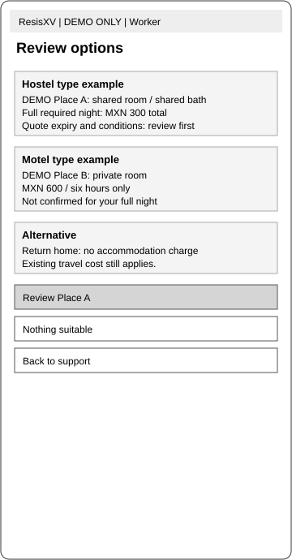

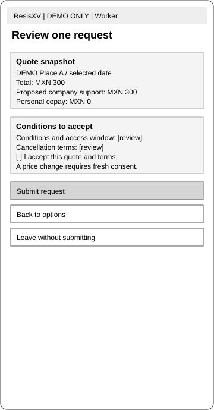

**1. Review options — F03.** Sebastián sees available accommodation for the requested hours, including the type of place, documented conditions and total price. The server filters out expired offers and incompatible arrival windows. It does not convert an unknown condition into a positive claim.

**2. Review one request — F04.** He checks total price, expected company support, personal copay, applicable terms and cancellation conditions. The server stores an immutable quote version and computes copay as total minus support. It blocks submission if the resulting personal obligation exceeds his accepted cap.

**3. Submit or leave.** Accepting the quote creates a pending request with a unique ID. Repeated taps or a network retry return the same result rather than creating another request. If nothing is suitable, he can change the night or return home. Detailed travel and alternative-cost comparison remain R2; essential price and condition disclosure are R1.

<!-- page -->
### Use Case 3: Receive a Funding Decision — Worker and Employer

**Trigger:** a request has been submitted. **End state:** it is confirmed, denied, expired or returned for renewed consent. Stories S13, S15, P02 and A02.

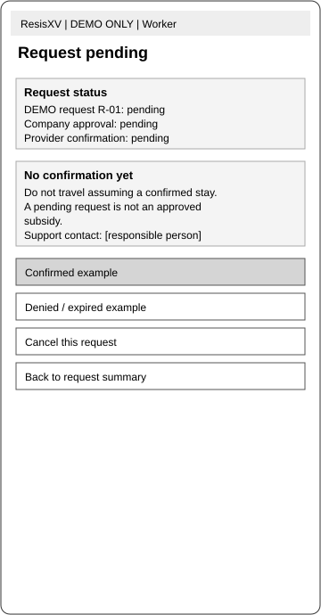

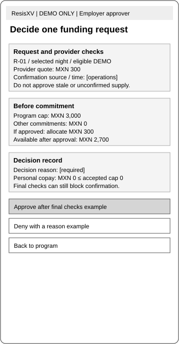

**1. Wait for a decision — F05.** Sebastián sees that his request is pending. Submission is not permission to travel. The server records the policy version, quote expiry and decision owner. R1 supplies a response contact; the fuller deadline/recovery interface is R2.

**2. Review the request — F11.** The authorized employer approver sees eligibility, the lodging subsidy, any employer-paid coordination fee and the combined commitment against available company funds. The fee breakdown is a PRD addition to this demo screen. Operations verifies availability and records the source, time, price and provider reference. No provider API is assumed.

**3. Confirm after all checks.** The server rechecks eligibility, quote validity, worker acceptance, capacity and funds. It holds company funds and internal capacity together in a database transaction. Provider confirmation remains a separate external action. The request becomes confirmed only when both the provider commitment and internal allocation are valid.

**4. Handle a failed check.** If approval, price or supply changes, F09 gives the reason. A higher copay requires new worker consent. Failure after an external commitment creates an operations case; it must not silently release funds while leaving a provider obligation unpaid.

<!-- page -->
### Use Case 4: Authorize and Reconcile a Shared Fund — Employer

**Trigger:** an authorized sponsor agrees to a limited support period. **End state:** the company can account for each commitment and charge. Stories P01–P03 and A01.

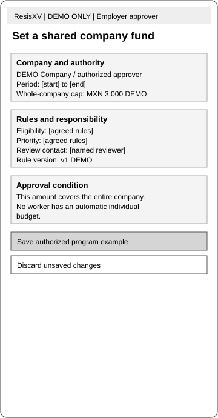

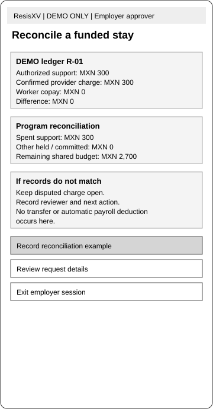

**1. Set a shared fund — F10.** The approver enters the period, approved cap, eligibility rules, priority rules and review route. The server verifies authorization and versions the policy. The amount applies to the company, not to every worker. Opening a new period does not alter existing commitments.

**2. Make individual decisions — F11.** The system calculates available funds as cap minus held and spent allocations. It rejects an approval that would exceed the cap, even if two approvers act at the same time. Every decision records actor, timestamp and reason.

**3. Reconcile the stay — F12.** After operations records the provider charge, the approver compares the authorized contribution with the actual amount. A mismatch creates an assigned case. Only an agreed final amount moves the allocation from held to spent; unused amounts are released once the remaining obligation is known.

**4. End the period.** New requests stop when funding expires, while valid commitments and disputes remain visible. Automated renewal and aggregate outcome dashboards are R3. R1 permits a manual continuation decision outside the product with a recorded new authorization.

<!-- page -->
### Use Case 5: Arrive, Rest and Evaluate — Sebastián

**Trigger:** the provider and support allocation are confirmed. **End state:** the stay is completed and its actual cost can be reviewed. Stories S17, S20 and A03.

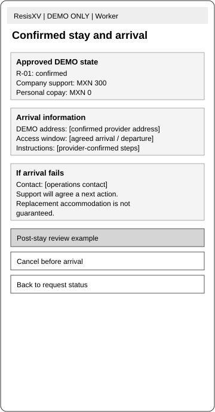

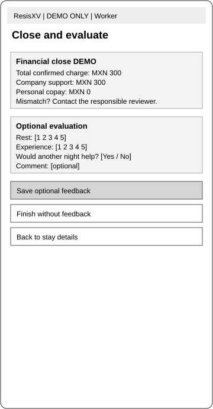

**1. Reach the accommodation — F06.** Sebastián receives the address, agreed arrival/departure hours, access instructions and responsible contact. The server displays the current confirmed record, not an earlier draft. The worker can review it again after signing in; no native app is required.

**2. Resolve an arrival problem.** If the provider cannot admit him or the conditions differ, he contacts operations. The coordinator opens a case linked to the request and records the practical next action. A replacement is offered only after its own supply, cost and consent checks. Structured self-service issue reporting is R2; a human response is required in R1.

**3. Review the result — F08.** After departure, Sebastián can check actual cost and voluntarily report rest, experience and willingness to repeat. The server links feedback to the stay for research access. It does not expose identifiable rest ratings or household information to the employer.

**4. Decide about another night.** He can finish without feedback and without another booking. A favorable rating is not a repeat purchase. Rest gain is measured separately using a comparable commute-night diary; no automatic attendance or productivity improvement is inferred.

<!-- page -->
### Use Case 6: Cancel or Receive a Clear Exception — Sebastián

**Trigger:** plans change, support is denied or suitable supply disappears. **End state:** the request has a reasoned state and any remaining obligation is explicit. Stories S12, S15, S16 and A03.

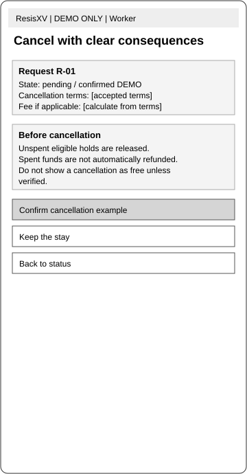

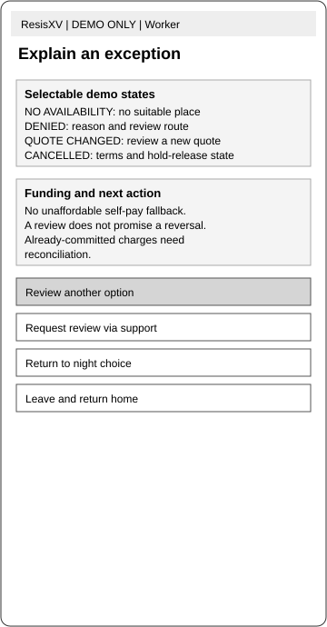

**1. Review cancellation — F07.** Sebastián sees the terms accepted for this request, the current provider status and any expected charge. The server calculates the consequence from the stored terms version. Cancellation is not assumed to mean a full refund.

**2. Confirm or keep the stay.** A confirmed cancellation updates the request and starts provider reconciliation. The server releases only the funds and capacity that no longer have an obligation attached. Repeated cancellation requests must not release the same allocation twice.

**3. Explain an exception — F09.** For denial, expiry, no availability or a changed quote, the screen shows a specific reason and available actions. Sebastián can change the night, request review or leave. An unaffordable copay is a reason to stop, not a prompt to accept more debt.

**4. Close the case.** Operations assigns unresolved charges or access complaints to a named owner. The worker receives a recorded outcome. The system retains disputed obligations until resolved and does not label a stay completed solely because the scheduled departure time passed.

<!-- page -->
## Detailed Design & Features Description

### Design Principles

**1. Clear commitment before convenience.** The worker must distinguish an estimate, a pending request and a confirmed stay. We will accept an extra confirmation step rather than permit one-click acceptance of an unclear personal charge. Price, support and copay appear together.

**2. One night is a choice.** The product serves a specific occasion. It will not default to recurring bookings or require household explanations to decline. This sacrifices recurring-volume assumptions in favor of voluntary use.

**3. Document conditions rather than promise safety.** A listing shows what was checked, when and by whom. Unknown facts remain unknown. The product will not use a general safety badge as a substitute for provider checks and a responsible contact.

**4. Make errors recoverable.** Every critical step provides a back or exit action. A retry does not duplicate a request or financial allocation. Unsaved edits can be discarded, while accepted obligations remain subject to their terms.

**5. Keep the first release operationally small.** A coordinator can confirm provider supply manually. Native apps, automated matching, payment custody and provider integrations are excluded from R1. We will use a short work queue before building a marketplace dashboard.

**6. Separate support from employment evaluation.** Employers need funding and reconciliation data. They do not need individual rest ratings or family circumstances. We will accept less granular reporting to preserve that separation.

These are proposed product rules. The interface takes inspiration from GOV.UK’s task-focused forms and Airbnb’s clear presentation of stay details, as design references rather than evidence of ResisXV demand. The initial product remains Spanish first, with readable contrast, text labels and controls suitable for a small phone. [H]

### Scope Boundaries

**In R1:** verified access, one-night requests, essential conditions and terms, shared-budget authorization, manual provider confirmation, status, cancellation, arrival contact, reconciliation and optional feedback.

**Out:** building or buying accommodation, providing medical or security guarantees, payroll deductions, holding card details, public marketplace launch and automated employment decisions.

**Coming:** fuller comparison and recovery tools in R2; aggregate review and renewal in R3. **External dependencies:** a purchasing authority, suitable provider offers, operating owners and confirmed payment/cancellation arrangements.

<!-- page -->
### Suggested Information Architecture

#### MVC

The MVP uses a responsive client, a server API and a transactional relational database. The server is authoritative for permissions, quotes, allocations and state changes. GitHub Pages may host a marketing or static prototype page; it cannot by itself run authenticated booking logic or store private operational records. [H]

| Model and main fields | View | Controller and processing |
|---|---|---|
| M01 Worker: id, contact, employer_id, work_location. Employer: id, authorized_approver_id. Account: id, role, verified_at. | V01 / F01 and verified-access entry; V07 employer session. | C01 checks identity, verified employment and role; returns records within the authorized worker/company scope. |
| M02 SupportProgram: employer_id, period_start/end, cap, rules_version, priority_rules, review_route. Eligibility: worker_id, program_id, status, reason, reviewer. | V02 / F02; V07 / F10. | C02 reads eligibility and policy to return an estimate. C08 creates an authorized policy version; renewal interface is R3. |
| M03 Accommodation: id, type, address, conditions_source, checked_at, access_hours, contact. NightAvailability: place_id, date/window, capacity, all_in_price, currency, quote_expiry, provider_reference. | V03 / F03; V05 / F06. | C03 filters offers by window, validity and required conditions. It returns facts and gaps, not an unsupported recommendation score. |
| M04 StayRequest: worker_id, offer_id, quote_version, lodging_total, subsidy, copay, employer_fee, accepted_cap, terms_version, status, deadline. SupportAllocation: request_id, program_id, subsidy_amount, fee_amount, total_commitment, state. | V04 / F04–F05, F07, F09; V07 / F11. | C04 checks permission, eligibility, combined commitment, capacity and consent; creates idempotent requests and allocations. C05 computes cancellation/expiry effects. |
| M05 StayRecord: request_id, check_in/out, actual_total/support/copay, reconciliation_state. SupportCase: request_id, category, owner, reason, resolution, closed_at. | V05 / F06; V06 / F08; V07 / F12; operations queue. | C06 coordinates access and cases. C07 reconciles actual charges, preserves disputes and settles valid allocations. |
| M06 Feedback: stay_id, consent, rest_rating, experience_rating, would_repeat, optional_comment. AuditEvent: actor, action, target, before/after state, timestamp, correlation_id. | V06 / F08; restricted research view. | C07 stores optional feedback. Authorized events create an audit record; employer APIs omit identifiable feedback fields. |

Money uses integer centavos and an explicit MXN currency code. Local stay times use the Mexico City timezone and retain timezone context; server timestamps use UTC. Foreign keys connect requests, allocations, stays and cases. A unique request token prevents duplicate submissions. [H]

<!-- page -->
#### Request and Allocation Logic

The main request sequence is draft → pending → confirmed → in_stay → completed. Denied, expired and cancelled are explicit branches. A request can carry an unresolved case independently of its stay state. Financial reconciliation is tracked separately; completed does not mean every charge is settled. [H]

| Transition | Required checks | Failure response |
|---|---|---|
| Draft to pending | Worker identity; valid quote and terms; full window; copay within accepted cap. | Retain draft with field-level reason; no commitment. |
| Pending to confirmed | Authorized approver; current eligibility; sufficient budget; capacity; current consent; provider reference. | Keep unconfirmed, deny or expire with reason; compensate any partial external commitment. |
| Confirmed to in_stay | Recorded provider/worker arrival confirmation. | Open an access case; do not fabricate check-in. |
| In_stay to completed | Departure evidence and stay record; identify unresolved charges. | Keep missing evidence assigned; settle money separately. |
| Pending/confirmed to cancelled | Applicable cancellation terms and provider acknowledgement. | Keep the obligation open until its value is known. |

**Budget invariant:** available = authorized cap − held allocations − spent allocations. Each allocation includes the lodging subsidy and employer-paid coordination fee; copay = lodging total − subsidy. Available cannot fall below zero. A transaction locks program and inventory rows before updating internal holds. Concurrent approvals for the final place must produce at most one valid allocation.

**Provider boundary:** a database transaction cannot guarantee a room in an external provider’s system. Operations records a time-bounded confirmation and rechecks it before final status. If provider confirmation succeeds and the internal commit fails, the coordinator cancels or reconciles the external obligation before closing the case.

**Worker consent:** a material price, subsidy, copay or term change produces a new version and requires acceptance before confirmation. No automatic payroll deduction or debit is introduced.

#### Minimum Operations Workspace

The worker/employer screen set does not contain a full coordinator console. R1 adds a role-restricted queue with request ID, night/window, provider contact, quote expiry, confirmation reference, commitment state, case owner and next action. Operations can verify supply, record access facts and reconcile cases. It cannot approve employer funds without the separate authorized role. [H; A02–A03]

**Acceptance checks:** duplicate submission returns the original ID; cross-company access is refused; two approvals cannot overspend a shared cap; stale quotes require renewal; repeated cancellation cannot double-release funds; a failed provider action leaves a visible case. A short coordinator walkthrough must pass before live use.

<!-- page -->
### Features

The ten R1 features below form one complete test of a supported stay. Confidence describes implementation confidence, not evidence of demand. All are proposed requirements. [H]

| Feature | Description and acceptance condition | Dependencies / owner | Priority; confidence; trace |
|---|---|---|---|
| FTR01 Verified access and one-night plan | Worker/company scope verified; date, hours and personal cap recorded. | Authentication and verified roster / engineering, sponsor. | v1; Medium; S03, S05; F01–F02. |
| FTR02 Company fund and eligibility | Versioned shared cap/rules; only an authorized approver can publish. | Purchasing authority / sponsor. | v1; Medium; P01, A01; F10. |
| FTR03 Essential offer facts | Current total, window, conditions and contact shown; expired offers blocked. | Dated provider offers / operations. | v1; Medium; S08, S10, S12; F03. |
| FTR04 Quote acceptance and request | Exact quote/terms stored; personal cap checked; retry is idempotent. | FTR01–03 / engineering. | v1; High; S08, S13; F04. |
| FTR05 Funding and supply confirmation | Valid provider reference plus atomic internal holds before confirmed status. | Sponsor decision, provider coordination / engineering, operations. | v1; Medium; P02, A02; F05, F11. |
| FTR06 Status and clear exceptions | Pending/confirmed/denied/expired are distinct; reasons and review contact present. | Request state / engineering, support. | v1; High; S13, S15; F05, F09. |
| FTR07 Cancellation and liability | Applicable consequence shown; only uncommitted funds released. | Agreed provider terms / operations, engineering. | v1; Medium; S16; F07, F09. |
| FTR08 Arrival and support queue | Confirmed instructions and contact; failed access assigned to an owner. | Staffed support window / operations. | v1; Medium; S17, A03; F06, queue. |
| FTR09 Reconciliation | Final support matched to charges; discrepancies remain open. | Provider charge evidence / finance, operations. | v1; Medium; P03; F12, F08. |
| FTR10 Optional outcome feedback | Consent recorded; employer cannot read individual responses. | Privacy/measurement protocol / PM, engineering. | v1; High; S20; F08. |
| Detailed comparison and recovery | Travel/cost detail, eligibility explanation, deadlines, issue/dispute forms. | Reliable comparison data and R1 learning / PM. | vNext; Medium; S01–02, S04, S06, S09, S11, S14, S18–19. |
| Aggregate review and renewal | Period utilization, privacy-preserving feedback, renew/revise/stop. | Sufficient records and sponsor process / PM, sponsor. | vLongterm; Low; S07, P04–P05. |

<!-- page -->
### Roadmap

#### v1 aka Minimum Viable Product

R1 is a controlled, one-company, one-worksite test of FTR01–FTR10. The unit is one completed, reconciled supported stay, with cost accepted in advance and a usable arrival arrangement. It is not an account, an app download or a room listing. [H]

The test begins with a manual concierge arrangement and static usability sessions. A transactional build is justified only if the first funding and supplier gates pass. The R1 software then supports the same worker, employer and coordinator path. It does not add a separate consumer marketplace.

**Available evidence:** interview summaries and coherent design artifacts exist. **Still to validate:** funding authority, two suitable provider offers, worker cost acceptance, operating response, financial controls, actual rest gain and contribution margin. There are no live-service validation results.

**Single feature closest to the main bet:** FTR05, funding and supply confirmation, connects the quoted stay to a feasible company commitment. The remaining features enable an accepted request to become an actual, accountable stay. If that overlap does not exist, polished search or a native app cannot rescue the MVP.

#### vNext

R2 adds richer travel and total-cost comparison, clearer eligibility detail and response deadlines, structured arrival issue reporting and charge disputes. The existing manual review and support routes remain available throughout R1. R2 should address observed friction rather than ship every planned enhancement automatically. [H]

**Available evidence:** these needs are represented in the stories, but no usage findings exist. **Still to validate:** which comparison facts change a decision, how quickly approval must happen, and whether structured tools reduce coordination effort.

#### vLongterm

R3 is the third release in the existing 12-week planning horizon. Its scope is limited to employer review and renewal. More distant options are exploratory and require another scope decision. [H]

- Aggregate utilization and outcome review, with small-group disclosure controls.
- Renew, revise or stop future periods while preserving accepted obligations.
- Consider additional sites or provider integrations only after repeatable operating economics.

**Available evidence:** I2 expresses budget and fairness concerns. **Still to validate:** renewal willingness, reporting usefulness and economics beyond one site. Automated matching and AI forecasts have no demonstrated MVP need and are not committed releases.

<!-- page -->
## Milestones / Timing

The schedule preserves the Module 5 plan: R1 at Week 6, R2 at Week 9 and R3 at Week 12. It starts after owners and a sponsor are confirmed. Relative weeks avoid representing unapproved dates as a delivery promise. Each owner below is a required role, not a confirmed hire. [H; S4]

| Week | Outcome and demonstration | Owner | Dependency / decision |
|---|---|---|---|
| 1 | Confirm buyer authority and record worker use occasions; show the feasibility register. | PM, sponsor lead | Access to actual decision maker. |
| 2 | Obtain two matched all-in offers and a draft support policy; demonstrate a full cost comparison. | Operations, sponsor | Provider response; worker conditions. |
| 3 | Test the request/denial flow with five volunteers; demonstrate that each understands pending vs confirmed. | PM, design | Quotes, terms and static screens. |
| 4 | Demonstrate access control, current offers and versioned request consent. | Engineering | Agreed records and roles. |
| 5 | Demonstrate concurrent approval, expiry, cancellation and financial reconciliation. | Engineering, QA, operations | Funding and provider workflow. |
| 6 | R1 internal demo and readiness reassessment; release only to the controlled pilot if gates pass. | PM, sponsor, operations | Written fund, acceptable supply, staffed support and no unresolved critical flow failure. |
| 7 | Begin authorized stays; demonstrate actual access and daily obligation reconciliation. | Operations | R1 readiness passed. |
| 8 | Review initial rest diaries, costs and reasons for refusal; select only justified R2 changes. | PM, research | Voluntary outcome data. |
| 9 | R2 demo: validated comparison/recovery improvements. | Engineering, PM | Observed priority and capacity. |
| 10 | Review company spending and suppression of identifying feedback. | Finance, PM | Reconciled stay records. |
| 11 | Demonstrate a proposed renewal decision using utilization and actual economics. | Sponsor, PM | Sufficient records; no assumed renewal. |
| 12 | R3 demo and pilot reassessment: continue, narrow, revert to concierge or stop. | PM, sponsor | Metric thresholds and direct-alternative comparison. |

### Go-to-Market Sequence

The proposed route is push, vertical, B2B2C and direct to the employer, with employer-mediated worker access. Start with one worksite and one authorized buyer. The worker-facing offer is voluntary participation; the employer-facing call to action is a pilot discussion. [H]

First identify authority and service conditions, then demonstrate the workflow, agree funding, recruit volunteers and run the controlled test. Broader acquisition follows evidence of usable stays and viable costs. The existing public repository and Pages address are presentation surfaces, not proof of a launched lodging service.

<!-- page -->
## Metrics

The primary metric tests whether a supported night produces an affordable, usable recovery outcome. Report raw counts with every percentage because the first pilot is small. Thresholds are proposed decision rules rather than forecasts or observed performance. [H]

| Metric | Definition and measurement | Proposed threshold and reason |
|---|---|---|
| **Primary: useful, affordable stay rate** | Confirmed stays that are completed, remain within the accepted final copay and have a voluntary matched diary showing at least 60 additional rest minutes, divided by all confirmed stays. Missing diaries do not count as success; report them separately. | By Week 12, at least 70%, with at least 10 confirmed stays and 5 distinct workers. A clear majority must receive the intended benefit; this is a decision signal, not statistical validation. |
| Funding and supply readiness | Written authorization for one period, verified approver and two matched suitable provider offers. PM checks the evidence register. | Complete by Week 2 before live commitment. This is the earliest leading indicator of whether I1 can use the service. |
| Decision comprehension | Volunteers who correctly identify status, copay and cancellation consequence in the prototype; five moderated sessions. | 5/5 distinguish pending from confirmed; at least 4/5 understand all three. A confirmation misunderstanding blocks the pilot until corrected. |
| Confirmation reliability | Confirmed stays admitted within the agreed window without provider-caused access failure / all confirmed stays; provider and worker records. | At least 90% by Week 12. Any serious unresolved access incident pauses further confirmations regardless of the rate. |
| Financial integrity | Overspent periods, duplicate allocations, unauthorized approvals and unexplained quote-to-final copay increases; event/ledger audit. | Zero before and during pilot. These are constraints, not errors that increased adoption can offset. |
| Voluntary repeat use | Workers completing a second accepted stay within 30 days of the first / workers with at least 30 days of follow-up. Record later use beyond Week 12 when needed. | At least 30% once five workers have a full observation window. Occasional demand makes daily/weekly activity inappropriate. |
| Contribution per stay | Collected coordination fee less variable coordination, incident and transaction costs; exclude lodging pass-through from fee revenue. | Positive by Week 12 with actual cost records. Also calculate monthly fixed-cost coverage before expansion. |
| Sponsor continuation | Authorized sponsor signs a subsequent funded period after reviewing use, outcomes and total cost. | One written continuation decision by Week 12 or an explicit stop/revise outcome. Interest alone does not pass. |

At Week 6, missing funding, supply or operational readiness keeps the service in prototype mode. At Week 12, missing sample minimums mean insufficient evidence, not a pass. Failure of economics or the primary outcome requires narrowing the segment, revising the service or stopping; technical completion alone does not justify expansion.

<!-- page -->
## Facebook Ads

Paid social advertising is not the first acquisition channel. Workers cannot use an unfunded promise, and broad traffic would not solve the buyer or supply constraint. The initial outreach goes directly to an authorized employer and then to eligible volunteers. This keeps the example’s acquisition section while matching ResisXV’s funding model. [H]

An exploratory message could say: “Explore a pilot for occasional stays near work.” It would invite an employer discussion, without promising lower absence, a guaranteed subsidy or a public nightly price. Any worker-facing notice must state that participation is voluntary and that support depends on the agreed program.

If a later campaign is justified, measure qualified employer conversations and funded pilots rather than clicks alone. A qualified lead has a relevant worksite, a reachable budget owner and willingness to discuss the service conditions. No ad campaign or lead collection has been launched by this document.

## Pricing Structure

Pricing separates the provider’s lodging charge from ResisXV’s coordination fee. The proposed starting model is an employer-paid fee per completed stay, with lodging passed through at the agreed price. This is a commercial hypothesis, not an offer accepted by a customer. [H]

| Component | Proposed treatment | Approval required |
|---|---|---|
| Lodging | Dated, all-in provider quote for the exact hours and occupancy. | Provider agreement and payer confirmation. |
| Employer contribution | Limited amount allocated from the shared approved period. | Authorized employer decision. |
| Worker copay | Total agreed stay liability minus employer contribution; never above the accepted cap. | Explicit worker acceptance of that version. |
| Coordination fee | Illustrative MXN 50 per completed stay, paid by the employer. | Buyer acceptance and positive operating margin. |
| Cancellation / incident costs | Follow the accepted terms; no automatic refund or replacement promise. | Responsibility agreed before a live pilot. |

The working model assumes the company’s weekly limit includes both its lodging subsidy and coordination fees. A different treatment requires explicit approval. For an illustrative zero-copay stay costing MXN 300 plus a MXN 50 fee, a MXN 3,000 fund supports at most eight stays, while MXN 4,000 supports eleven, before other costs. Neither price nor fund is secured.

No subscription tier or public MXN 100 selling price is established. I4’s stated limit cannot set the lodging price or Sebastián’s contribution. Before accepting a request, the service must identify who receives payment, when it occurs and who bears a cancelled or disputed charge. R1 does not store cards or hold worker deposits. [H]

<!-- page -->
## Projected Costs

### Engineering Costs

The following ranges are planning assumptions for an R1 transactional pilot after feasibility passes. They are not supplier quotes. Rates, task hours and staffing must be replaced with estimates from the people responsible for the build. All amounts are MXN; taxes and financing are excluded. [H]

| Workstream | Hours low–high | Cost at MXN 300–600/hour | Scope |
|---|---|---|---|
| Scope, records and interface refinement | 32–48 | 9,600–28,800 | Existing wireframes, operations queue and accepted terms. |
| Identity, roles and program setup | 40–64 | 12,000–38,400 | Worker/company separation and versioned rules. |
| Offers, requests and consent | 48–72 | 14,400–43,200 | Current quotes, caps and idempotent submission. |
| Confirmation, holds and cancellation | 64–96 | 19,200–57,600 | Transaction controls and provider reconciliation. |
| Arrival, cases and closeout | 40–64 | 12,000–38,400 | Operations work queue, charges and feedback. |
| QA, access review and deployment | 48–72 | 14,400–43,200 | Failure/concurrency tests, recovery and controlled release. |
| **Total** | **272–416** | **81,600–249,600** | **6.8–10.4 person-weeks at 40 hours/week.** |

With a 15% contingency, the build range is MXN 93,840–287,040. Calendar duration depends on staffing and external decisions. A 12-week board is not evidence that these engineering hours or procurement lead times have been secured.

The leaner first step is the concierge test: use existing screens, verify offers and make a small number of manually coordinated arrangements under agreed controls. No software build budget should be committed solely because the PRD exists.

### Marketing / Other Costs

| Pilot item | Planning range | Basis / timing |
|---|---|---|
| Employer outreach and discovery | 1,600–3,200 | 8–16 hours at MXN 200/hour; Weeks 1–2. |
| Provider visits and local travel | 1,000–2,000 | Allowance for two matched offers; Weeks 1–2. |
| Usability-session reimbursements | 500–1,000 | Five volunteers at MXN 100–200; Week 3. |
| Pilot notice and materials | 500–1,000 | Simple direct communication; before recruitment. |
| Commercial/privacy review | 3,000–6,000 | Unquoted allowance; before paid stays. |
| **Total before build and lodging** | **6,600–13,200** | **Assumptions; no spending authorized.** |

<!-- page -->
### Unit Economics

The following scenarios test the coordination business, not the return on owning a building. Accommodation investment and property operation are outside this MVP. Gross lodging spending must not be reported as platform revenue. [H]

| Per completed stay | Efficient coordination case | Manual, slower case |
|---|---|---|
| Provider charge, passed through | MXN 300 | MXN 300 |
| ResisXV coordination fee revenue | MXN 50 | MXN 50 |
| Coordinator time at MXN 120/hour | 15 minutes = MXN 30 | 30 minutes = MXN 60 |
| Incident / transaction allowance | MXN 5 | MXN 5 |
| Contribution before fixed cost | MXN 15 | −MXN 15 |

These figures show why coordination effort is a central risk. At the efficient case, 40 completed stays per month contribute MXN 600. Assumed monthly infrastructure of MXN 600–1,500 alone requires 40–100 stays to cover it, before other overhead. At the slower case, additional volume increases the loss unless price or service effort changes.

**CAC and payback:** an assumed MXN 1,600–3,200 acquisition cost for one funded employer, divided by MXN 600 monthly contribution at 40 stays, gives 2.7–5.3 months before fixed costs. It does not establish actual payback; after fixed costs the illustrated employer may be unprofitable. LTV cannot be estimated credibly without observed renewal and churn. [H]

## Operational Needs

| Need | Required provider / owner role | Planning cost and start |
|---|---|---|
| Supplier checks and quote refresh | Operations coordinator; provider confirms facts. | Setup visits above; per-stay time above; Week 2. |
| Funding decisions and ledger review | Authorized sponsor approver; finance review. | Employer-owned time, unquoted; agreed before Week 6. |
| Arrival-window support and escalation | Named coordinator plus reachable provider contact. | MXN 120/hour assumption; required coverage hours unpriced and must be agreed before live use. |
| Case and charge resolution | Operations and finance; owner on every case. | Handling allowance above; unresolved cases require additional measured time. |
| Hosting, database, messages and backup | Technical maintenance owner, not yet staffed. | MXN 600–1,500/month infrastructure; start at controlled deployment. |
| Maintenance and access review | Engineer or contracted maintainer. | 4–8 hours/month at MXN 300–600 = MXN 1,200–4,800, additional to infrastructure. |
| Optional outcome research | PM; employer sees no identifiable feedback. | 4–8 hours in the pilot, unquoted PM time; Week 7 onward. |

Response coverage is a launch dependency. Per-stay handling cost does not pay for unstaffed overnight standby. If the agreed arrival window cannot be supported at an acceptable total cost, restrict the hours or stop live bookings.

<!-- page -->
## Risks

Likelihood and impact are qualitative planning judgments. They identify the tests and owners required before a service is offered; they do not imply measured incident rates. [H]

| Risk | Likelihood / impact | Mitigation and stop condition | Owner |
|---|---|---|---|
| No overlap between accepted copay, subsidy and suitable supply. Product-killing risk; H4/H5. | High / Critical | Two matched quotes; written fund; real worker choices; cost model including fees and coverage. Stop if no workable overlap. | PM, sponsor, operations. |
| Interested contact cannot authorize spending. | Medium / Critical | Verify purchasing authority and budget period in writing. No live commitment on interview interest. | Sponsor lead. |
| Approval creates over-budget or duplicate obligations. | Medium / High | Transaction locks, unique request tokens, ledger reconciliation and concurrent-request tests. Any unexplained breach pauses approvals. | Engineering, finance. |
| Provider price or inventory changes after an internal hold. | High / High | Quote expiry, recorded provider confirmation and compensation workflow. No confirmed status on an unverified offer. | Operations. |
| Arrival fails or conditions materially differ. | Medium / Critical | Check access and conditions; staffed contact; documented escalation. Serious unresolved incident pauses new stays. | Operations, provider. |
| Scarce places create conflict or perceived unfairness. | High / High | Agree allocation rules and a review route with sponsor and workers. Keep participation voluntary. | Sponsor, PM. |
| Household needs make nights away unattractive. | Medium / High | Occasion-specific choice and diary; retain emergency-use branch. No routine-stay assumption. | PM. |
| Private feedback affects employment decisions. | Medium / High | Separate permissions; omit individual responses from employer APIs; suppress small groups and free text. | Technical owner, PM. |
| Coordination or support cost exceeds fee revenue. | High / Critical | Time every case and price required coverage; compare concierge and direct booking. No expansion on negative contribution. | Operations, finance. |
| Claimed rest or attendance improvement is unsupported. | High / High | Matched voluntary diary; separate rest from travel savings. Do not market absence reduction without evidence. | PM. |
| Provider/legal/payment responsibilities remain unclear. | Medium / Critical | Agree contracts, payer, cancellation, complaint handling and local requirements with appropriate advisers before paid stays. | Sponsor, operations. |
| Insufficient staff or build capacity delays the test. | High / Medium | Confirm owners and estimates; keep test manual if feasible. Revise the schedule rather than imply an unstaffed launch. | PM. |

No pilot result can offset unresolved personal-cost consent, serious access failures or unauthorized financial commitments.

<!-- page -->
## Partnerships

The initial service needs an authorized employer, at least one suitable accommodation provider and a responsible operating coordinator. No partnership is established by this PRD. Public provider pages are comparison sources, not partner endorsements.

The employer defines the funded period, budget owner and allocation process. The provider confirms price, occupancy, hours, documented conditions and cancellation terms. ResisXV coordinates the accepted request and keeps a traceable record. The agreement must specify who pays the provider and who resolves a failed stay or disputed charge. [H]

Transport or mapping services are optional later dependencies. R1 can display a sourced local-travel estimate without a real-time integration. Any future provider API must support verifiable inventory, quote expiry, confirmation references and cancellation reconciliation; an API does not remove the need for operating ownership.

## International

The initial scope is one Mexico City worksite and nearby accommodation. Expansion outside Mexico is not part of the current releases. The product should support Unicode names, MXN amounts, Mexico City local stay times and Spanish interface text. Before use in another jurisdiction, review accommodation, payment, employment and data responsibilities for that location. Translating the screens alone is insufficient. [H]

## Group Members

**Andrés Rojas — student product owner and author.** Responsible for the course concept, requirements synthesis, research follow-up and scope decisions.

Engineering, design implementation, QA, finance, sponsor and provider roles describe required responsibilities. No additional team member, employer relationship or staffing commitment has been confirmed in the project sources. I1–I4 are research references, not project team members. No partnership with Gavil or another company is asserted. [S2]

### Decision Summary

Proceed with prototype and supplier feasibility work. A paid pilot depends on written funding, acceptable offers, voluntary worker acceptance, a responsible operating team and agreed financial terms. A completed software build is not sufficient to launch.

If the manual arrangement solves the job more cheaply, keep the service simple. If no acceptable combination of rest benefit, worker cost and sponsor economics exists, revise the segment or stop. The next decision is whether one supported night can work for the people involved. [H]

<!-- page -->
## Sources and Open Items

### Sources

S1. Supplied Interview.html, October 2026: I1 Sebastián; I2 Luis Felipe; I3 Angélica; I4 record labelled Jocelyn / Manolo. Interview summaries are paraphrases. Exact dates, recruitment relationships and I4 identity need clarification.

S2. ResisXV_Final_MRD_Module5.docx and MRD_ResisXV_Module5.md, October 29, 2026. Includes corrected budget scope, evidence limitations, hypothesis register, alternatives and market scenarios.

S3. User_Story_Board_ResisXV_Module5.md; Journey_Workflow_ResisXV.md; MVC_ResisXV.md, October 29, 2026. Story and architecture sources for the proposed service.

S4. Scrum_Data_ResisXV.json and the 12-week Scrum Board, Module 5. Source for R1 Week 6, R2 Week 9 and R3 Week 12; dates and staffing remain proposed.

S5. Screen_Flow_ResisXV_Module5.md; F01–F12.svg; Wireframe_Data_ResisXV_Module5.json, October 29, 2026. Screen images are static demo designs, not implemented behavior or real provider quotes.

S6. Ficha de persona José Martínez en fábrica.png and 01_Final_Persona_Jose_Martinez.pdf, October 2026. Original generated portrait reused as an illustration. Historical persona claims are superseded by the Module 5 MRD.

S7. Hotel y Villas Patriotismo. Villa Master. https://hotelyvillaspatriotismo.com/habitaciones/villa-master/ . Accessed November 12, 2026. Public rate and terms are not a date-specific overnight offer for this pilot.

S8. Hostal Regina. Official website. https://reginacdmx.webflow.io/ . Accessed November 12, 2026. Room formats and facilities; no current dated worker quote assumed.

S9. INEGI. (2026, May 26). Encuesta Nacional de Ocupación y Empleo, Ciudad de México, primer trimestre de 2026, Boletín 310/26. https://www.inegi.org.mx/contenidos/saladeprensa/boletines/2026/enoe/enoe2026_05_CdMx.pdf . Historical population context only.

S10. InstaVacay PRD, updated November 15, 2020, supplied PDF; PM101 PRD outline and relevant product-management guidance. Reference for section order, persona narrative, illustrated use cases, MVC, releases, metrics, pricing, costs and risks. It supplies no evidence of ResisXV demand.

### Open Items

1. Identify the authorized buyer, reconcile the funding period and secure the proposed terms. Owner: sponsor lead; close through buyer follow-up and GTM readiness.
2. Obtain two matched dated provider offers and the required access/support coverage. Owner: operations; close through supplier feasibility testing.
3. Confirm worker copay acceptance and collect actual rest diaries without transferring I4’s budget to I1. Owner: PM; close through persona and JTBD follow-up.
4. Clarify I4 identity, interview dates and recruitment relationships. Owner: PM; close in the interview record and carry the correction into the MRD.
5. Price the build, ongoing maintenance and staffed coverage with responsible providers. Owner: engineering/operations; replace [H] ranges before funding a launch.
6. Test the new operations queue and existing worker/employer flows, including retries and partial commitments. Owner: QA and operations; close through wireframe testing and the R1 acceptance checks.
7. Confirm payer, cancellation, privacy, retention and complaint responsibilities. Owner: sponsor and operations with appropriate advisers; close before collecting live operational data or accepting paid stays.

This is the completed requirements specification for the proposed pilot. Open commercial, research and operating decisions remain launch dependencies; none is represented as an achieved result.
